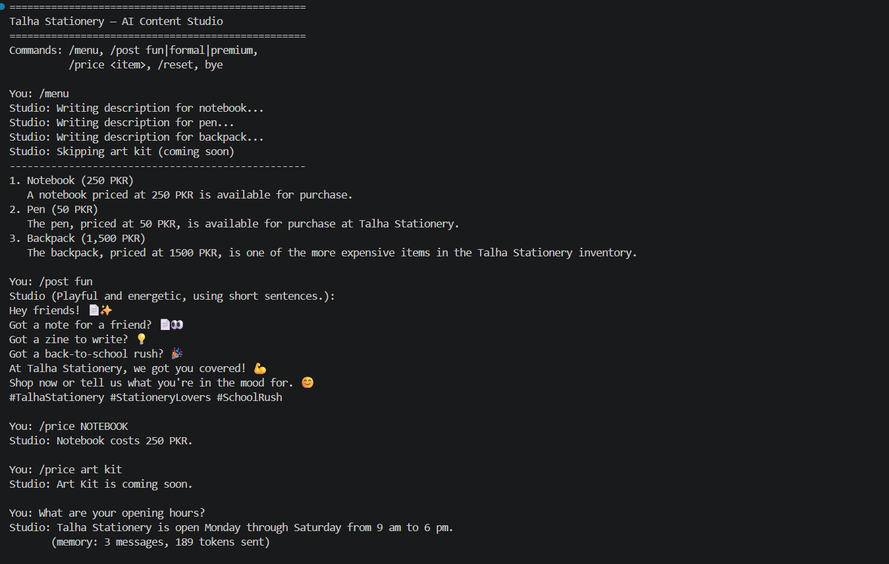
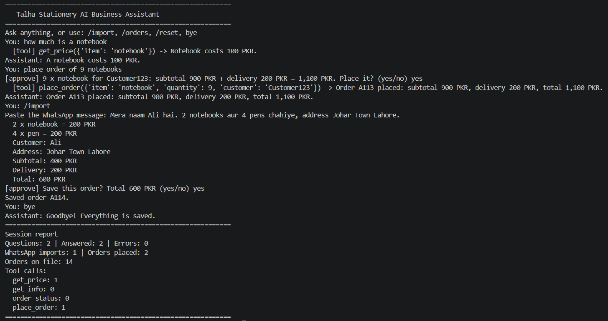

# Python for AI — Muhammad Talha Mumtaz

My goal is to become an AI Engineer and build useful tools for businesses.

## Run the project

```powershell
uv run main.py
```

## Completed tasks

- Task 1.1: AI career introduction
- Task 1.2: Development toolkit verification

## Checkpoint 1 Project: AI Prompt Kit

A Python tool that creates three AI prompts from a business's details.

### Run

```powershell
uv run code/project_m1_prompt_kit.py
```


Potential customers: small business owners who need help writing clear instructions for AI.

## Task 1.8: Business Helper Bot

| Intent | Keywords | Reply |
|---|---|---|
| Complaint | refund, complaint, order is late | Please contact our support team for help. |
| Greeting | hi, hello | Welcome! How can I help? |
| Opening hours | hours, timings | Support is available 24/7. |
| Delivery | delivery, shipping | Delivery normally takes 2–5 working days. |
| Payment | payment, pay | We accept bank transfers and cash on delivery both. |
| Returns | return | Contact support to check return eligibility. |

## Module 1 Final Project: AI Front Desk

A Python front desk for Talha Stationery that answers FAQs, calculates quotes with discounts and delivery, and prepares AI prompts for unanswered questions.

Business details and prices are examples.

### Run

```powershell
uv run code/project_m1_front_desk.py
```

## Module 2 Checkpoint 1: AI Content Studio

A local AI studio for Talha Stationery that writes product descriptions, streams social posts, looks up exact prices, and answers customer questions using the shop's facts.

### Run

```powershell
uv run code/project_m2_content_studio.py
```



This could save the owner time by preparing product and social content and answering common questions from one tool.

## Module 2 Final Project: AI Business Assistant

A local AI assistant for Talha Stationery in Lahore. It answers customer questions from the shop's business data, looks up product prices, checks order statuses, and prepares orders for owner approval. It can also extract and check order details from pasted WhatsApp messages.

### Run

Start Ollama and make sure the `qwen2.5:3b` model is available. Then run:

```powershell
cd code
uv run project_m2_business_assistant.py
```

### Tools

| Tool | What it does |
|---|---|
| `get_price` | Looks up a product's price in the business data. |
| `get_info` | Answers questions using the shop's business information. |
| `order_status` | Checks an order's status in the saved orders. |
| `place_order` | Calculates the order total and saves the order only after owner approval. |

The `/import` command extracts and checks order details from pasted WhatsApp messages. It calculates totals in Python and saves an order only after owner approval.

This assistant saves the owner time by answering routine customer questions and checking orders. A business could pay monthly to reduce repetitive customer-service work.



See [Module 2 final project results](docs/project-m2-final-results.md) for the test details.