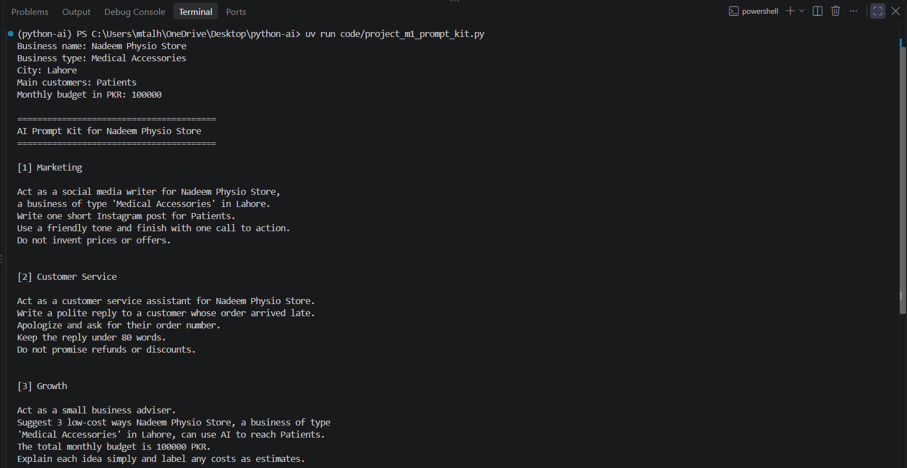

# Python for AI — Muhammad Talha Mumtaz

My goal is to become an AI Engineer and build useful tools for businesses.

## Run the project

uv run main.py

## Completed tasks

- Task 1.1: AI career introduction
- Task 1.2: Development toolkit verification


## Checkpoint 1 Project: AI Prompt Kit

A Python tool that creates three AI prompts from a business's details.

Run:
uv run code/project_m1_prompt_kit.py



Potential customers: small business owners who need help writing
clear instructions for AI.


## Task 1.8: Business Helper Bot

| Intent | Keywords | Reply |
|---|---|---|
| Complaint | refund, complaint, order is late | Please contact our support team for help. |
| Greeting | hi, hello | Welcome! How can I help? |
| Opening hours | hours, timings | Support is available 24/7. |
| Delivery | delivery, shipping | Delivery normally takes 2–5 working days. |
| Payment | payment, pay | We accept bank transfers and cash on delivery both. |
| Returns | return | Contact support to check return eligibility. |


## Module 1 Final Project: AI Front Desk

A Python front desk for Talha Stationery that answers FAQs,
calculates quotes with discounts and delivery, and prepares
AI prompts for unanswered questions.

Business details and prices are examples.

### Run

```powershell
uv run code/project_m1_front_desk.py